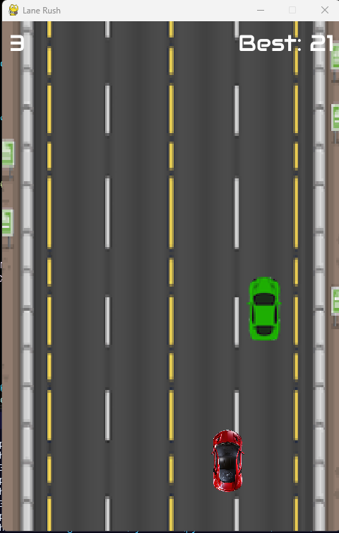

# Lane Rush

> [!NOTE]
> Python isn't required only if you download the .exe (for Windows), or the .dmg (for MacOS)

Lane Rush is a great, fun and simple car maneuvaring game. Your goal is simple, use your `←` and `→` or your `a` and `d` keys.

## Download

### For Windows:

1. Go to the releases page and select the latest release
2. Scroll down until you reach the assets tab
3. Then, go ahead and download the executable file
4. Run the executable file and start playing

### For MacOS:

1. Go to the releases page and select the latest release
2. Scroll down until you reach the assets tab
3. Then, go ahead and download the .dmg file
4. Open the .dmg file and drag the .app file from there into your applications folder or wherever you want
5. Run the .app file and start playing

## Keys:

| Key | Action |
|-----|--------|
| ← / A | Move left |
| → / D | Move right |

## License

[Apache License 2.0](LICENSE)